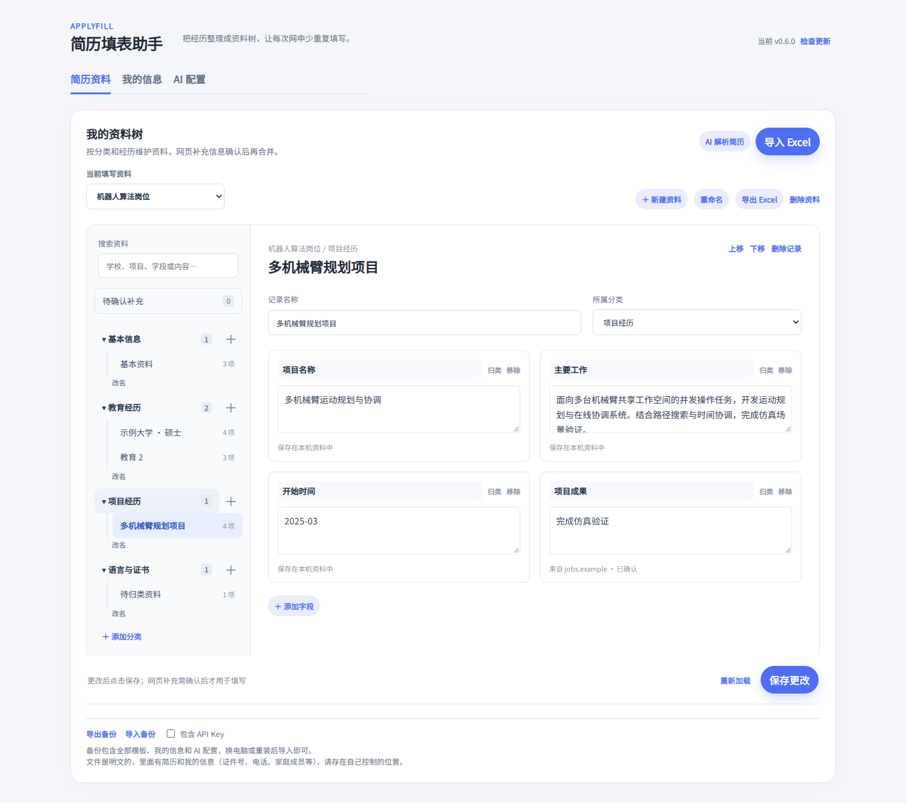

# ApplyFill 0.6.0：树状资料管理

## 使用方式

1. 打开扩展管理页的「简历资料」。现有 Excel 模板会自动转换成可折叠的分类与经历目录，字段名称和值保持不变。
2. 在左侧选中经历，在右侧编辑字段。可添加分类、记录与字段，调整记录顺序，或通过「归类」移动单个字段。
3. 点击「保存更改」。只有保存后的内容才会用于网申填写；关闭页面或切换资料前会提示未保存更改。
4. 上传 PDF / Word / TXT 后，解析结果直接保存成资料树。Excel 导入和导出继续保留。
5. 在网申页面手动补完内容后，点击「采集到资料树」。内容先进入当前资料的「待确认补充」，并记录来源网站与日期。
6. 逐项选择所属记录，再选择新增字段或更新已有字段。更新时会显示旧值和新值；确认归属后，仍需保存更改才生效。仅与本次申请有关的答案可忽略。



## 从旧版升级

- 先在旧版管理页导出一份备份。
- 解压新版，将文件覆盖到原来加载扩展的目录中。
- 在 `chrome://extensions` 或 `edge://extensions` 点击 ApplyFill 的「重新加载」。
- 刷新已打开的管理页和网申页。不要先卸载扩展，卸载会删除浏览器中的扩展数据。
- 初次打开管理页会保存树状结构迁移。编号字段（例如“教育1学校”）和旧版解析器的经历前缀会被归为同一记录；无法确定归属的字段放在「待归类资料」，可手动归类。

## 数据与兼容

- 分类、记录和字段有稳定编号，改名、移动与排序不会更换这些编号。
- 原有 `groups[].fields[]` 继续作为填写和 Excel 导出的兼容结构；`records` 与字段的 `recordId` / `label` 保存树结构。
- 网页采集内容保存在独立的 `pending` 列表，确认前不参与自动填写。
- 编辑记录名称、所属分类、字段名称或顺序后，旧平台映射会重新学习；控件结构观察保留。只修改字段值不清理映射。
- JSON 备份升级为版本 3，保留固定编号、记录结构、来源与待确认补充；仍可读取旧版 1 / 2 备份。Excel 只导出已确认字段的分类、名称和值，不承载稳定编号与待确认内容，完整迁移请使用 JSON 备份。
- 同时在多个页面编辑同一份资料，过期保存会被拒绝并保留编辑区内容，避免覆盖其他页面刚保存的内容。

## 本次范围

这是树状资料编辑器的第一版。原有「我的信息」仍负责跨模板通用补充资料，多套模板继续独立维护。没有新增自由拖拽的思维导图画布、共用主档案的岗位视图或投递问答归档系统。0.6.1 补充修复了占位下拉、生日来源、无来源联系方式和映射身份；详见 [填写准确性与回归测试](fill-accuracy.md)。

## 验证

```bash
node --test tests/*.test.js
```

浏览器管理页交互回归：

```bash
npm ci
npx playwright install chromium
npm run test:ui
```

可使用 `CHROMIUM_EXECUTABLE_PATH` 指定已有 Chromium。浏览器测试运行真实管理页代码；扩展存储接口与模型响应使用匿名测试替身，不访问真实招聘网站、不发送简历到模型。覆盖迁移、编辑保存、固定编号、搜索、补充确认、未保存数据保护、JSON 备份、Excel 往返、窄屏布局和 TXT 导入。
